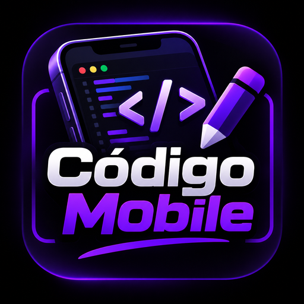

# Código Mobile

<p align="center">
  
</p>

## • Visão geral

**Código Mobile** é um editor de código e IDE para Android com terminal
Linux (Alpine) integrado, contexto de projeto único compartilhado entre o
explorador de arquivos e o terminal, e um painel de **Agentes de IA**
(Claude Code, OpenAI Codex CLI, OpenCode) que detecta o que está
realmente instalado no sandbox e abre direto no seu projeto.

## • Principais recursos

- Edição de código com suporte a múltiplas linguagens (HTML, CSS,
  JavaScript, Python, Java e mais).
- Terminal Linux (Alpine) embutido, com contexto de projeto ativo
  (`ACODE_PROJECT_ROOT`): abrir um terminal já entra na pasta do projeto
  aberto no explorador de arquivos.
- Painel **Agentes de IA** para detectar e abrir Claude Code, Codex CLI e
  OpenCode no projeto ativo.
- Integração S/FTP e SSH.
- Console JavaScript embutido.
- Suporte a plugins da comunidade.
- Identidade visual escura por padrão.

## • Instalação

Este projeto não é distribuído pela Play Store ou F-Droid. O APK é gerado
automaticamente pelo GitHub Actions a cada atualização do código: veja a
aba **Actions** do repositório, abra a execução mais recente e baixe o
artefato em "Artifacts".

## • Estrutura do projeto

<pre>
.
|
|- src/   - Código-fonte e arquivos de idioma
|
|- www/   - Documentos públicos, arquivos compilados e templates HTML
|
|- utils/ - Ferramentas de linha de comando para build e afins
|
|- codemirror-lsp-client/ - Submódulo git (clone com --recurse-submodules)
</pre>

## • Suporte a múltiplos idiomas

Para adicionar um novo idioma, crie um arquivo com o código do idioma
(ex.: `en-us` para inglês) em [`src/lang/`](src/lang/) e inclua em
[`src/lib/lang.js`](src/lib/lang.js). Há utilitários de linha de comando
para gerenciar as strings:

```shell
npm run lang add
npm run lang remove
npm run lang search
npm run lang update
```

## • Build e contribuição

Veja [CONTRIBUTING.md](CONTRIBUTING.md) para instruções detalhadas, e
[docs/DEVELOPER_EDITION.md](docs/DEVELOPER_EDITION.md) para o relatório
completo de implementação (o que foi feito, testado, não testado e
pendente), e [LEIA-ME.txt](LEIA-ME.txt) para um resumo em português.

## • Créditos e licença

Código Mobile é um fork do [Acode](https://github.com/Acode-Foundation/Acode)
(© 2020 Foxdebug/Ajit Kumar), distribuído sob a **Licença MIT** - veja
[LICENSE](LICENSE). A licença exige manter o aviso de copyright original
nas cópias do software, por isso ele permanece no arquivo de licença; o
restante do projeto (nome, identidade visual, textos e as mudanças
descritas acima) é deste fork.
